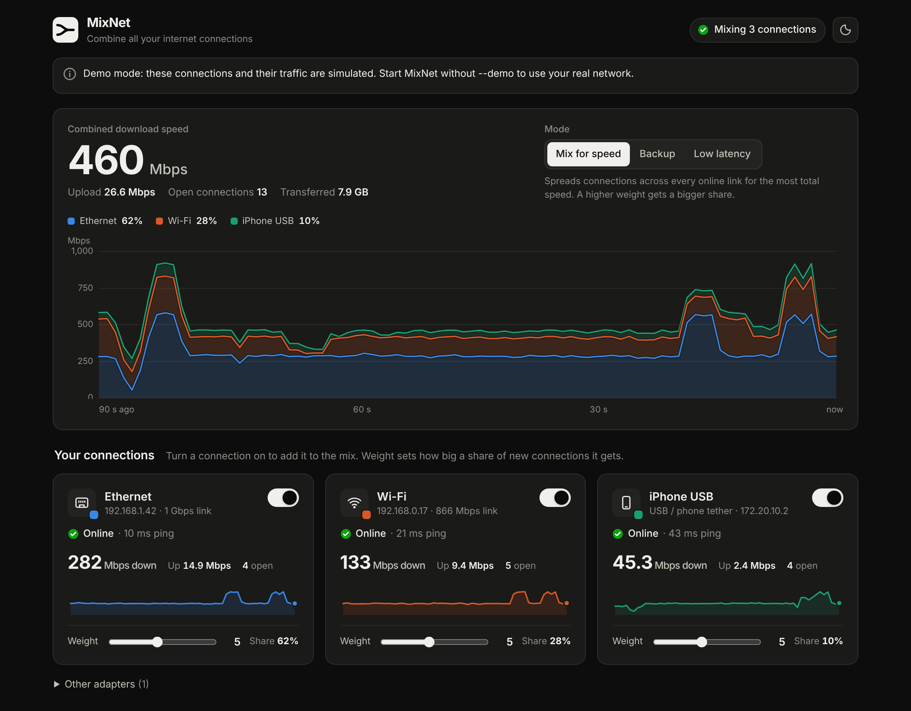

# MixNet

Use all your internet connections at once: Wi-Fi, Ethernet, a phone tethered over USB, a second Wi-Fi adapter, a 4G/5G dongle. MixNet runs on your computer, spreads your apps' traffic across every connection, and moves traffic off a connection the moment it drops. A live dashboard shows how much each link carries.



Works on **Windows, macOS and Linux**. Needs Python 3.9+ and one package (`psutil`). No account, no server, no VPN.

## Quick start

1. Connect to **more than one network**, e.g. join Wi-Fi *and* plug in an Ethernet cable, or tether your phone over USB.
2. Start MixNet:
   - **Windows:** double-click `start-windows.bat`
   - **macOS / Linux:** run `./start.sh`
   - **Any OS:** `python -m pip install psutil`, then `python -m mixnet`
3. The dashboard opens at <http://127.0.0.1:8899>. Turn on **"Send this computer's apps through MixNet"**.

To see the dashboard without touching your network, run it with simulated connections:

```bash
python -m mixnet --demo
```

## What you can do in the dashboard

| | |
|---|---|
| **Combined speed** | Live download/upload across all links, with a 90-second chart that shows how much each link contributes. |
| **Your connections** | Every adapter MixNet found, with health (online / no internet), ping, current speed and open connections. Switch a link on or off and set its **weight** (1–10). |
| **Modes** | **Mix for speed** spreads connections over all links, weighted. **Backup** uses your highest-weight link and fails over to the others. **Low latency** sends each new connection over the link with the lowest ping. |
| **Speed test** | Measures each link on its own, then all of them mixed. One click turns the results into weights. |
| **Use the mix** | Point the whole computer at MixNet, copy the proxy address for a single app, share the mix with other devices on your network, or keep each website on one link. |
| **Live activity** | The most recent connections and which link each one went over. |

## How it works

MixNet runs a local proxy on `127.0.0.1:1080` that speaks both **HTTP** and **SOCKS5**. Each new connection an app makes through it is assigned to one link and pinned to that adapter:

- **Linux:** `SO_BINDTODEVICE`
- **macOS:** `IP_BOUND_IF`
- **Windows:** binding to the adapter's address, which Windows' strong-host model routes out of that adapter

The balancer picks links by *weighted least connections*. A link with weight 8 gets about four times as many new connections as one with weight 2, and a slow link that is still busy gets fewer.

Every 5 seconds MixNet checks each link by opening a connection to 1.1.1.1, 8.8.8.8 or 9.9.9.9 through it. A link that fails twice is taken out of the mix and put back as soon as it answers again. If a connection attempt fails on one link, MixNet retries it on another right away, so apps rarely notice.

"Send this computer's apps through MixNet" installs a small proxy auto-config file (PAC) in your system settings. It tells apps to use MixNet and, **if MixNet isn't running, to connect directly**, so closing or crashing MixNet never cuts you off. Your previous settings are saved and restored when MixNet exits, or on its next start if it was killed.

### What it can and can't speed up

Mixing works **per connection**:

- **Faster:** browsers (pages load from many connections at once), download managers with multiple segments, Steam and other game launchers, cloud sync, `git`, package managers, and several downloads or streams at the same time. Failover helps everything.
- **Not faster:** a *single* connection, such as one plain file download, runs over one link. Splitting one connection across links needs a bonding server on the internet to reassemble the pieces; paid services such as Speedify run those servers. See [Roadmap](#roadmap).
- **Not covered yet:** UDP traffic (most games' live traffic, voice calls, QUIC/HTTP-3) and apps that ignore proxy settings. Browsers fall back from QUIC to regular HTTPS when a proxy is set, so web browsing is fully covered.

## Using it from other apps and devices

- **One app:** set its proxy to `127.0.0.1:1080` (HTTP or SOCKS5). For command-line tools:

  ```bash
  curl -x socks5h://127.0.0.1:1080 https://example.com
  ```

- **Other devices (phone, console, laptop):** turn on **"Share with other devices on my network"**. On the device, set the Wi-Fi network's HTTP proxy to the address the dashboard shows, e.g. `192.168.1.42:1080`. Anyone on your network can use the proxy while this is on, so only enable it on networks you trust.

## Settings and command line

```text
python -m mixnet [--proxy-port 1080] [--ui-port 8899] [--no-browser] [--demo]
```

Settings (mode, weights, which links are on) are saved in `~/.mixnet/config.json`. Set `MIXNET_HOME` to store them elsewhere.

## Troubleshooting

- **Only one connection shows up.** Both links must be connected at the same time. Some Windows laptops turn Wi-Fi off when a cable is plugged in: in Device Manager, open your Wi-Fi adapter's **Advanced** tab and set *"Disable Upon Wired Connect"* (or similar) to **Disabled**.
- **A link says "No internet".** It has an address but couldn't reach the internet (no gateway, captive portal, or a firewall blocking the check). MixNet won't use it until it can.
- **Linux: traffic doesn't spread.** Pinning needs kernel 5.7+ or root, and the dashboard warns you if it can't pin. Each link also needs its own default route (NetworkManager adds one per connection). If replies are dropped, use loose reverse-path filtering: `sudo sysctl -w net.ipv4.conf.all.rp_filter=2`.
- **The system-proxy switch is greyed out on Linux.** Automatic setup uses `gsettings` (GNOME, Cinnamon, Budgie, Unity). On KDE and other desktops, set the proxy to `127.0.0.1:1080` in system settings. When run with `sudo`, MixNet can't change your desktop's settings.
- **The speed test fails with a certificate error on macOS.** Run *Install Certificates.command* from your Python folder in Applications.
- **"Port already in use".** MixNet is probably already running. Otherwise pick other ports with `--proxy-port` / `--ui-port`.

## Security

- The dashboard listens on `127.0.0.1` only. It rejects requests addressed to any other host name (DNS-rebinding protection) and changes that don't carry its own header, so other websites can't change your settings.
- The proxy listens on `127.0.0.1` unless you turn on sharing. It has no password, so share it only on trusted networks.

## Development

```text
mixnet/
  interfaces.py   find adapters, classify them, pin sockets to one
  engine.py       links, health checks, balancing, stats
  proxy.py        SOCKS5 + HTTP proxy on one port
  speedtest.py    per-link and mixed speed test
  sysproxy.py     system proxy (PAC) on Windows, macOS, GNOME
  web.py          dashboard server and JSON API (stdlib only)
  demo.py         simulated links for --demo
  static/         the dashboard (plain HTML, CSS, JS, no build step)
tests/            end-to-end tests over real loopback sockets
```

Run the tests:

```bash
python -m unittest discover -s tests -v
```

## Roadmap

- **Bonding server** (optional, self-hosted on a small VPS): split *single* connections across links and reassemble them on the server, for true Speedify-style bonding of one download or video call.
- UDP support (SOCKS5 UDP ASSOCIATE) for games and calls.
- System tray icon and start-on-login.
- Packaged installers (no Python needed).
